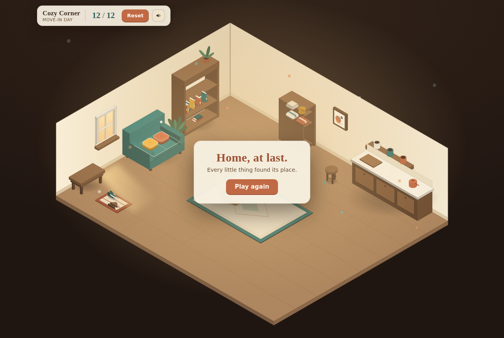

# Cozy Corner — a tiny tidying game (Upgrade 1: free placement, collections, replayable mess)

A one-level browser tidying game, built with **Vite + vanilla TypeScript +
SVG** (no React, no game engine, no runtime dependencies). Someone just moved
in: an open box spilled **28 belongings** across the floor. Put things anywhere
they physically fit, gather each book color onto one clean shelf tier, and
watch the room transform.



**Play online:** https://mohamedazzam4.github.io/Tidy-Game/ — every push to
`main` rebuilds and republishes the site via GitHub Actions.

## Run it

```bash
npm install
npm run dev        # dev server → http://localhost:3000
```

Other commands:

```bash
npm test           # Vitest: game-rule + level-data + scatter tests (75 tests)
npm run build      # typecheck (tsc --noEmit) + production build to dist/
npm run preview    # serve the production build → http://localhost:4173
```

End-to-end check (real pointer drags in headless Chromium; requires
`playwright` + its Chromium browser, not in `package.json`):

```bash
node scripts/e2e.cjs                              # against the dev server
BASE_URL=http://localhost:4173/ node scripts/e2e.cjs   # against the build
```

Add `?seed=<0..4294967295>` to the URL to pin a layout — the same seed always
produces the same mess (used by the e2e suite for determinism).

## How to play

- **Drag** any of the 28 scattered items with the mouse (Pointer Events).
- **Free placement**: an item can rest anywhere it physically fits — the open
  floor, the kitchen counter, the sofa seat, the bench, the stool, the linen
  boards, or a bookshelf tier. A dashed outline shows the footprint: soft teal
  = it fits, dimmed with a strike = it does not. Physical information only —
  the game never hints whether a move helps a collection.
- **Shelf slots** still snap (forgiving radius, ghost outline): books stand
  upright on the rebuilt 4-tier bookshelf (16 slots), mugs on the kitchen
  rack, cushions on the sofa, shoes on the entry mat, towels on the linen
  shelf.
- **Collections**: the 12 books form three collections of four (red, green,
  blue). A collection counts when its four books share **one shelf tier** with
  **nothing unrelated on that tier** — any of the four tiers works, and the
  other tiers never interfere. Mixed or incomplete shelves are perfectly legal
  temporary placements and stay silent.
- Completing a collection triggers a **soft chime** and a short animation at
  that tier (muted if sound is off). Breaking one is quiet; putting a book
  straight back never replays the celebration.
- **Winning**: the level completes when every item rests on a valid
  non-floor placement **and** all three collections are complete at the same
  time. The HUD chips show each collection's current state; the counter counts
  non-floor placements.
- **Reset** replays the same seeded layout; **New Mess** draws a fresh one.
  "Play again" on the completion card behaves as New Mess. Press **Escape**
  mid-drag to cancel; invalid drops restore the previous position — nothing
  is ever lost or duplicated.

## Where things live

| Path | Responsibility |
| --- | --- |
| `src/level/house.level.ts` | **The level.** Room dimensions, furniture, 28 items with start poses, 5 destination zones with slot anchors, the surface registry entries and collections. |
| `src/level/footprints.ts` | Pure physical registry: item footprints per asset + orientation, furniture floor-exclusion AABBs, occupied-slot ghost reservations, static-decor obstacles (C-7). |
| `src/game/types.ts` | Shared level/model types: `SurfaceDef`, `CollectionDef`, footprint tables, the `DropTarget` union, room-coordinate invariants. |
| `src/game/model.ts` | Pure game rules: unified `drop(itemId, DropTarget)`, surface physics (`validateSurfaceDrop`: bounds, clearance, non-overlap, furniture exclusion), slot reservations, collections (`collectionStatus()`, tier-clean rule), tidy-all completion, committed-change anti-spam. No DOM imports. |
| `src/game/scatter.ts` | Seeded scatter (mulberry32, rejection sampling + fallback chain) and the pure validators: `isLayoutReachable`, `hasValidArrangement` (slots-only solver through the model's own predicates), `parseSeedParam`. |
| `src/view/assets.ts` | Asset catalog: self-authored SVG builders keyed by asset id + variant (12 collection books with spine markings, 4 variants per non-book group), `data-surface` hit-test tags, paint-part splitting for the bookshelf/linen shelf. |
| `src/view/projection.ts` | The one shared isometric projection (±30° axes, vertical walls) used by floor, walls, furniture, items and ghosts alike. |
| `src/view/scene.ts` | Builds the layered SVG room: merged support-relative paint list, per-slot and per-surface ghosts. |
| `src/view/gameView.ts` | Rendering + input: pointer → room coordinates, surface-plane aiming, drag pipeline (slot → surface → floor), fit/no-fit ghosts, commit consumer (sound, settle, chips, tier feedback), Reset/New Mess, HUD. |
| `src/view/audio.ts` | Tiny synthesized sounds (WebAudio, local, mutable) + the read-only `lastSfx` log used by e2e. |

## Architecture notes

- **Model/view split.** The view asks the model whether a drop is valid
  (`findDropTarget`, `validateSurfaceDrop`, `drop`); it never invents rules.
  Slots are matched against their *approach point* (anchor shifted by the
  difference between carry height and slot height); surfaces are aimed through
  the surface's own plane (the floor-projected pointer shifts by
  `(+topZ, +topZ)` — the exact inverse of the projector's z offset).
- **True isometric.** The camera looks into the open front corner of a
  10 × 8 room; floor axes slope +30°/−30°, wall edges stay vertical, no
  perspective. `toScreen`/`toFloor` invert each other, so drag-and-drop
  stays accurate at any window size.
- **Support-relative painter's algorithm.** Furniture and items share one
  merged, depth-sorted paint list: floor items key plain `x + y`; items resting
  on furniture key the support's depth + ε, so a shelf never paints over the
  books standing on it. The bookshelf and linen shelf split into back/front
  paint parts so their near side panels occlude correctly.
- **One occupancy mechanism.** Occupied slots reserve their category ghost
  footprint on their hosting surface, so free surface drops and slot occupants
  share the same non-overlap rule — including shoe slots on the walkable entry
  mat, which reserve on the `floor` surface entry.
- **No correctness hints.** Collection state is exposed only through
  `collectionStatus()` and commit-time `collectionCompleted`; the preview
  pipeline never touches it (asserted pure-side and in the browser).

## Assets

All artwork is **original, hand-written SVG** in `src/view/assets.ts`
(furniture, items, room shell). No external or hotlinked assets are used,
so there is no third-party license to track. Sounds are synthesized at
runtime with WebAudio.

## Checks performed

- `npm test` — 75 Vitest tests: drops, categories, occupied slots, surface
  physics (bounds/clearance/overlap/furniture), restore + conflict fallback,
  re-drag from every location kind, tier-clean collections (mixed tiers,
  interchangeable tiers, simultaneous completions, quiet breaks, put-back and
  cancel-restore anti-spam), tidy-all gating, seeded scatter safety +
  reachability over 100 seeds, slots-only solver with budget reporting,
  seed-parameter validation, HUD-vs-card consistency, and level-data sanity.
- `npm run build` — strict TypeScript + production bundle (~18.4 kB gzipped JS,
  within the ~25 kB budget).
- Browser suite (Playwright, real mouse drags — `scripts/e2e.cjs`, layouts
  pinned via `?seed=11`): the playable slice (floor drop persists, invalid
  floor drops restore, counter drop lands within ε_aim 0.05, undersized
  surfaces restore, Escape restores, ghost suppression), the full 28-item
  playthrough via the winning arrangement, Reset (identical layout) and
  New Mess (different layout, chips cleared), collections by real drags
  (3 green + 1 red silent; the 4th green animates its tier and chimes once;
  put-back replays nothing; the mute gate records muted chime calls), tier
  interchangeability in a second run, the drag-lifecycle zero-invocation
  assertion of `collectionStatus`, and a drag after resizing the viewport —
  with zero console errors.

## Limitations

- Single level, no persistence, no gamepad/keyboard-only dragging
  (Escape cancels, but items are mouse/touch-driven).
- Item footprints do not rotate for validity checks (display-only rotation).
- Camera work (two fixed views / free rotation) was analyzed and deliberately
  deferred; the hint system is designed-for but not implemented.
- The audio is intentionally minimal and is off until the first interaction
  (browser autoplay rules).
