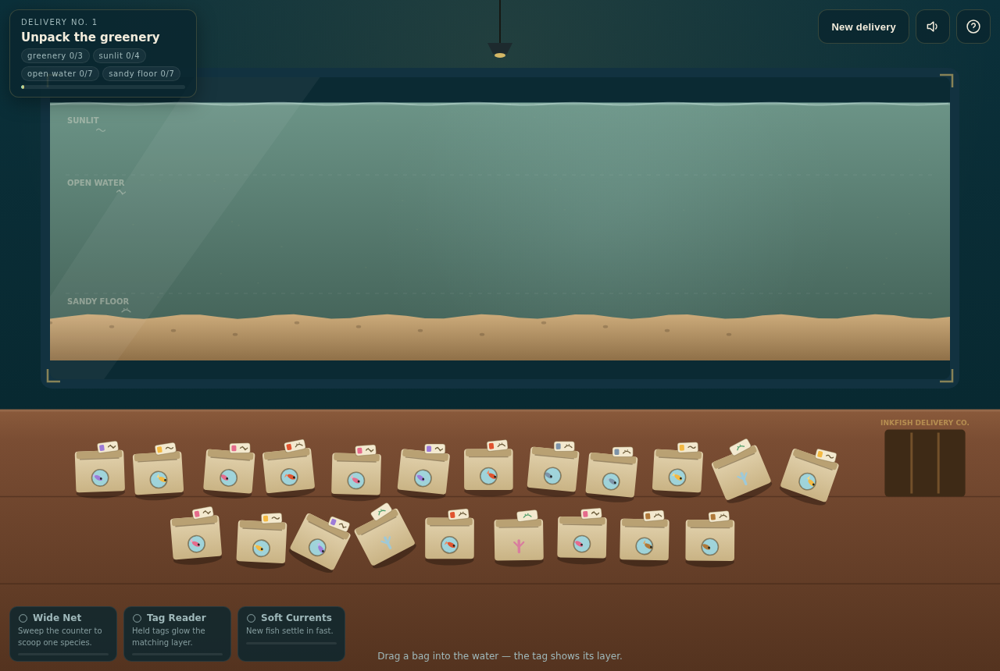
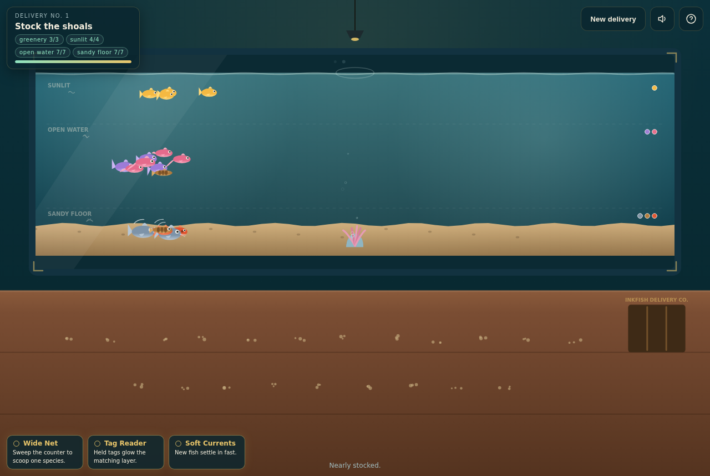

# Tide & Tidy

A calm aquarium stocking sim. A delivery of sleepy fish sits bagged on a workshop counter; read each tag, release every fish into the water layer it prefers, and watch murky water clear and shoals form. No timers, no failure state — just plops, ripples, and a tank that slowly comes alive.

Built as a single self-contained `index.html` (Canvas 2D + Web Audio API, no dependencies, no build step). Lives alongside the existing Cozy Corner game without touching its code, following the `games/<name>/` branch convention used by `games/potion-cellar/`.




---

## The concept (and the two that lost)

Three substantially different directions were explored before building:

| Concept | Loop | Why it lost |
| --- | --- | --- |
| **Stained-glass restoration** — sort storm-scattered shards by hue into a caddy, snap them into a window that slowly lights up | hue-sorting into compartments, static payoff | The payoff is a static picture, and hue-matching can read as a color-vision test. Group handling had no natural story. |
| **Dawn bakery case** — sort cooling pastries into a display case, flip the OPEN sign | type-sorting into slots | Structurally a shelf with slots — too close a cousin of the reference's binders-on-shelves. |
| **Tide & Tidy** (built) — bagged fish on a counter, released into depth layers, shoals form | depth-sorting into living water | Winner: the "container that visibly fills" is *alive*, the groups literally school together, and the plop is a repeatable physical joy that varies by fish. |

What makes it its own game, not a reskin: the destination is a **habitat layer** (a region, not a slot), the objects **keep moving after placement** (shoal AI), and the sorting rule comes from **reading a physical tag** (species + preferred depth) rather than matching symbols on slots.

## Core loop

1. **Read a tag.** Every bag carries a paper tag with a species color chip, a depth glyph (waves / tilde / dots), and a little window showing the fish swimming inside.
2. **Drag it into the water.** Release inside the matching layer (Sunlit / Open water / Sandy floor).
3. **Watch it settle.** A plop with a splash and ripple at the waterline, a bubble trail as the fish glides down, a little swirl from same-species neighbors as it joins its shoal. The murky water clears one step.
4. Mistakes are soft: a wrong layer leaves the fish dimmed and puzzled (`?`), catchable with one tap. A drop on the counter re-bags the fish exactly where it came from. No penalties, no counters of shame.
5. When every fish is home: the lamp sweeps on, every shoal parades once across the tank, and a completion card appears. Then watch the tank, or press `R` for a fresh randomized delivery.

## The one original interaction: the Wide Net sweep

The skill that earns its place because of *what* you're organizing: you're a keeper, so you get a **net**. After 4 placements you unlock **Wide Net** — press on an empty counter spot and sweep: a dashed circle grows from the anchor and **nets fish of one species as the rim passes them** (the first catch locks the species; capacity 5). The gesture flows straight into a carry, so a single motion goes sweep → lift → release into the water, ending in a drumroll of staggered plops that climb a pentatonic ladder as the shoal grows. The sorting decision (which layer) is never made for you; only the trips are removed.

## Skill system (in-session, no shop, no grind)

| Unlocks at | Skill | Effect |
| --- | --- | --- |
| 4 placements | **Wide Net** | Sweep empty counter to scoop one whole species (up to 5) at once |
| 8 placements | **Tag Reader** | Held tags glow the matching layer + per-band pulse; per-species progress dots on each layer's edge |
| 12 placements | **Soft Currents** | Settle animation 0.55s → 0.3s; ripples calm faster |

Each unlock is a toast + a stamped slot in the bottom-left strip. Skills reset with each delivery — the calm loop is the session, not a meta-progression treadmill.

## Random generation (seeded, always solvable, always readable)

- Seed via `?seed=` (deterministic, shareable) or `Date.now()` — a fresh look every delivery.
- All 6 species appear, counts randomized per species (16–21 fish total), each species mapped to exactly one true layer, every layer guaranteed ≥ 3 fish so the tank visibly fills in all three zones.
- 3–4 greenery bags (kelp, stone, bubble stone, fan coral) sprinkled among the fish bags — free floor placement, a zero-pressure way to learn the drag.
- Counter layout: rows with jitter, no overlap (asserted by runtime self-checks), a few tipped bags, the delivery crate reserved on the right.

Runtime self-checks (see `selfCheckWorld` in the file) assert every invariant above on every generation, on load and on each new delivery; failures are exposed via `window.__tide.selfChecks()`.

## Sound design (all synthesized, Web Audio)

| Event | Sound |
| --- | --- |
| Pickup | bag rustle (band-passed noise) + wet slip (falling sine) |
| Correct plop | splash noise + droplet sweep pitched by fish size + sub thump + **one pentatonic step that climbs with the shoal's size** |
| Multi-plop | staggered plops = a rising pentatonic run |
| Wrong layer | a single soft low "blub" — neutral, never punishing |
| Skill unlock | two-note marimba |
| Completion | five-note pentatonic phrase + low pad swell, then the underwater room-tone fades in |
| Ambient | filtered brown-noise water hum, quiet bubbly blips |

The "song of the tank" is deliberate: each species has a pentatonic root; as its shoal grows, each newcomer plays the next degree. The tank literally becomes more musical as it fills — cumulative, never a streak, nothing to lose.

## What the reference's players said, and what it changed

From the public comments on *Filing Good: Tidy Up (demo)* (treated as individual observations, not universal laws):

- **Luisak** wished they could "use your hand to move several sheets... Having to drag them one by one was a bit uncomfortable" and wanted capacity upgrades. → The **Wide Net sweep** is the whole answer: group handling as an earned keeper's skill, not a shortcut that skips the sorting decision.
- **JavaJack** reported mouse-hand cramps. → One motion per group (sweep → release), no keyboard needed for travel, no scrolling, no view panning — the whole play space fits one screen.
- **JavaJack**: completion "needs WAY more fanfare... That dialog isn't sufficient reward." → The finale is a 6-second ceremony (lamp sweep, full-tank parade, bubble burst) *before* the card, and the card itself carries session stats.
- **beetroots_beans**: "this shut my brain up" / the dev's stated goal. → Guarded everywhere: no timer, no failure, no combo meters, soft murk that clears, ambient hum after the first few placements.

## Mouse + touch

One pointer-events pipeline. Mouse: drag, right-click or `Esc` to let go safely. Touch: tap-drag anywhere; the tag card floats above the finger; `touch-action: none` keeps the page pinned (verified). Buttons ≥ 40px; bags scale down to fit phone counters and keep a generous hit radius. `prefers-reduced-motion` halves particles and stills the caustics.

## How to run

```bash
# local
cd games/tide-and-tidy
python3 -m http.server 8080        # open http://localhost:8080

# e2e (repo root)
python3 -m http.server 8081        # serve repo root
npm i --no-save playwright@1.57   # once
node scripts/e2e-tide.cjs
```

On GitHub Pages (once the branch is served): `https://mohamedazzam4.github.io/Tidy-Game/games/tide-and-tidy/`

## Controls

- **Drag** a bag into the water (or sweep empty counter once Wide Net is learned).
- **Tap** a dimmed fish to scoop it back out.
- `R` new delivery · `M` mute · `Esc` let go · right-click let go.

## File layout

```
games/tide-and-tidy/
├── index.html               # the whole game (~1,600 lines, markup + styles + logic)
├── README.md                # this file
├── screenshot-initial.png   # seeded start state
└── screenshot-complete.png  # finished tank
```

## Ponytail notes (smallest complete change)

- No new dependencies: Canvas 2D + Web Audio are browser-native.
- No build step, no backend, no asset files; art and audio generated at runtime.
- Cozy Corner's `src/`, `index.html`, workflow, and `main` are untouched; this game lives on the `tide-and-tidy` branch only.
- Self-checks instead of a unit-test suite; `scripts/e2e-tide.cjs` covers the rest with real pointer drags.

### Skipped (named, deliberately)

- No XP/persistent meta-progression — the calm loop is the session; skills reset per delivery.
- No save slots or share codes — seeds in the URL give shareable layouts already.
- No endless/arcade mode — "Watch the tank" and a fresh delivery cover replay.
- No fish-compatibility rules beyond depth (no predator/prey logic) — kept readable.

### Risks

- Web Audio requires a user gesture; audio starts on the Start button (or first tap).
- `localStorage` (mute preference, delivery count) is per-origin; clearing it resets flavor only.
- Synthesized sound is tuned by parameter, not by ear in a DAW; plops are gentle by construction.
